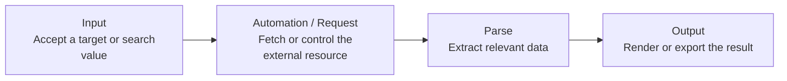

# OUTLOOKWIN32

**Portfolio project** · A JavaScript automation example for opening or composing Outlook content on Windows.

## Overview

A JavaScript automation example for opening or composing Outlook content on Windows.

## Technology Stack

- `Node.js`
- `JavaScript`

## How the Repository Works

| Stage | Responsibility |
|---|---|
| **Input** | Accept a target or search value |
| **Automation / Request** | Fetch or control the external resource |
| **Parse** | Extract relevant data |
| **Output** | Render or export the result |

## Concepts Covered

- JavaScript runtime
- Asynchronous I/O
- Modules and packages
- HTTP or CLI workflows
- External integrations

## Repository Map

- `.gitignore`
- `openemail.js`
- `package-lock.json`
- `package.json`

## Recruiter Summary

This repository demonstrates practical implementation skills, repository organization, and an end-to-end understanding of the project workflow. It is suitable as a focused example of applied software or data work.

---

Documentation is concise and project-focused; source code was not modified.
