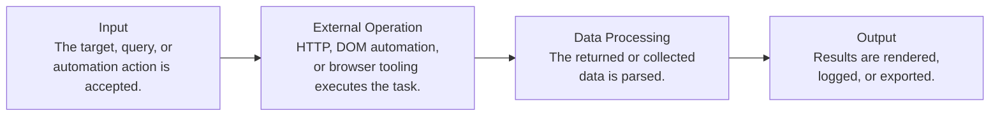

# OUTLOOKWIN32

A JavaScript automation example for opening Outlook-related actions on Windows.

## Overview

The repository contains an implemented application or analysis project with code organized around its primary runtime, interface, data, or automation responsibilities.

## Key Features

- Node.js command execution or server runtime
- Modular source organization
- External I/O or API integration
- Scripted or interactive output

## Technology Stack

| Area | Technology |
|---|---|
| Platform | Node.js |
| Library / Framework / Tool | JavaScript |

## Architecture and Data Flow

| Stage | Responsibility |
|---|---|
| **Input** | The target, query, or automation action is accepted. |
| **External Operation** | HTTP, DOM automation, or browser tooling executes the task. |
| **Data Processing** | The returned or collected data is parsed. |
| **Output** | Results are rendered, logged, or exported. |

## Repository Structure

- `.gitignore`
- `openemail.js`
- `package-lock.json`
- `package.json`

## Setup

1. Install Node.js and npm.
2. Run `npm install` from the repository root.
3. Start the project with the applicable script below.

## Usage

Run the repository entry point using the language or platform documented in the setup section.

## Configuration

Review `package.json` for available scripts and runtime dependencies. Add environment variables locally only when a feature requires external credentials or service configuration.

## Verification

- Run the project entry point and verify the primary success and error paths.
